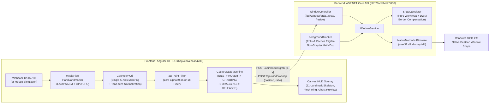

# W.A.V.E 🌊

> **"Windows Are Very Easily-moved"**
> Touchless, spatial window manager for Windows — built for **Crown Hacks**.

W.A.V.E turns your laptop webcam into a local, zero-latency spatial controller for native Windows desktop apps. Pinch in mid-air to grab the window under your hand, drag toward a screen edge or corner to preview the landing zone, and release to snap real OS windows (Notepad, Chrome, VS Code, Explorer) flush into place.

- **100% Local Vision:** Powered by `@mediapipe/tasks-vision` (`HandLandmarker` in `VIDEO` mode with GPU delegate + CPU fallback) bundled offline in `frontend/src/assets/mediapipe/`. Zero video frames ever leave the browser.
- **Native Win32 Precision:** ASP.NET Core Web API backend (`user32.dll`, `dwmapi.dll`, `shcore.dll`) with per-monitor DPI awareness (`PER_MONITOR_AWARE_V2`), work-area awareness (`rcWork` so the taskbar is never covered), and DWM Extended Frame Bounds compensation (`DWMWA_EXTENDED_FRAME_BOUNDS`) so snapped windows sit flush with zero invisible-border gaps.
- **Mouse Simulation Mode Included:** Toggle **Simulation Mode** in the HUD header to test or demo the entire gesture state machine and Win32 snapping pipeline with your mouse (click = pinch, drag = move, release = snap) — no webcam or studio lighting required.

---

## Repository Structure

Frontend and backend live in strictly separated top-level folders and build/run independently:

```text
scepter/
├── README.md              # Setup, architecture, run instructions, 60s demo script
├── .gitignore             # Root gitignore for .NET and Angular/Node artifacts
├── frontend/              # Angular 18 standalone app (http://localhost:4200)
│   ├── src/
│   │   ├── index.html     # <title>WAVEHUD</title> (used by backend to ignore self)
│   │   ├── assets/mediapipe/ # Local offline hand_landmarker.task + WASM binaries
│   │   └── app/
│   │       ├── core/
│   │       │   ├── models/   # landmark.model.ts, gesture.model.ts, snap-action.model.ts
│   │       │   ├── services/ # camera, hand-tracker, gesture-engine, window-api, settings
│   │       │   └── utils/    # lerp.ts (Lerp & One Euro 1€ filters), geometry.ts (mirrorX)
│   │       └── features/
│   │           ├── scepter-shell/   # Main spatial workspace, telemetry, simulation mode
│   │           ├── hud-overlay/     # 60 FPS Canvas skeleton, pinch ring, ghost preview
│   │           └── settings-panel/  # Live-tunable sliders persisted to localStorage
└── backend/               # ASP.NET Core Web API (.NET 8, http://localhost:5000)
    ├── Scepter.slnx
    ├── Scepter.Api/
    │   ├── Program.cs
    │   ├── appsettings.json
    │   ├── Controllers/WindowController.cs
    │   ├── Services/IWindowService.cs, WindowService.cs, ForegroundTracker.cs, SnapCalculator.cs
    │   ├── Native/NativeMethods.cs, NativeStructs.cs
    │   └── Models/SnapPosition.cs, GrabRequest.cs, SnapRequest.cs, SnapResult.cs
    └── Scepter.Api.Tests/
        └── SnapCalculatorTests.cs   # Pure xUnit rectangle & DWM border math tests
```

---

## Architecture Diagram



---

## Prerequisites

- **OS:** Windows 10 or Windows 11 (required for Win32 window manipulation; non-Windows platforms start the API and return HTTP `501 Not Implemented` for window actions).
- **.NET SDK:** .NET 8.0 SDK (or .NET 9/10 SDK targeting `net8.0`).
- **Node.js & npm:** Node.js `v18.19+` or `v20+` and `npm`.
- **Webcam:** Any standard USB or integrated laptop webcam (optional when using **Simulation Mode**).

---

## Backend Setup & Run (`/backend`)

1. Open a terminal in `backend/Scepter.Api` and start the API:
   ```powershell
   cd backend/Scepter.Api
   dotnet run
   ```
   - The server binds to `http://localhost:5000`.
   - Swagger UI is available in Development at `http://localhost:5000/swagger`.
   - Health check endpoint: `GET http://localhost:5000/health` -> `{"status":"ok","platform":"windows",...}`.

2. Run the backend unit test suite (`xUnit`):
   ```powershell
   cd backend/Scepter.Api.Tests
   dotnet test
   ```

---

## Frontend Setup & Run (`/frontend`)

1. Open a second terminal in `frontend`, install dependencies, and start the dev server:
   ```powershell
   cd frontend
   npm install
   npm start
   ```
   *(Or run `npx ng serve` — serves at `http://localhost:4200`.)*

2. Run the frontend gesture state-machine unit tests (`Vitest`):
   ```powershell
   cd frontend
   npm test
   ```

---

## Tunable Parameters (Live in Settings Panel)

All parameters can be tuned live in the **Spatial Calibration** sidebar and persist automatically to `localStorage`:

| Parameter | Default | Description |
| :--- | :--- | :--- |
| **Cursor Smoothing Filter** | `Lerp` | Switch live between Linear Interpolation (`Lerp`) and adaptive `One Euro (1€)` filtering. |
| **Lerp Smoothing Alpha** | `0.35` | `smoothed = prev + (raw - prev) * alpha`. Applied **before** edge-zone threshold checks. |
| **Pinch Enter Threshold** | `0.28` | Thumb-to-index distance normalized by hand size (wrist `#0` to middle MCP `#9`), calibrated to `~0.055` raw units at arm's length. |
| **Hysteresis Exit Multiplier** | `1.50x` | Exit threshold = `enter * 1.50` (`0.42`). Eliminates pinch boundary flicker. |
| **Edge Snap Zone Width** | `20%` | Screen edge margin (`X < 0.20` Left, `X > 0.80` Right, `Y < 0.20` Top Maximize, plus 4 corners). |
| **Zone Arm Dwell Time** | `150 ms` | Time the pinched cursor must dwell inside an edge zone before it arms and pulses gold. |
| **Snap Release Cooldown** | `800 ms` | Minimum time between consecutive snap actions; releasing outside an armed zone cancels the grab. |
| **Left/Right Split Ratio** | `50%` | Width ratio (`0.30` – `0.70`) sent to `POST /api/window/snap`. |
| **Stretch Gestures** | Enabled | **4-Corner Quarter Snaps**, **Throw Flick (`nextMonitor`)**, and **2-Hand Simultaneous Pinch Resize**. |

---

## 60-Second Judge Demo Script

1. **0:00 – 0:10 | Launch & Target Lock:**
   Open **Notepad** (or VS Code) alongside the **W.A.V.E** browser window (`http://localhost:4200`). Point out the green **Win32 API Ready** indicator, the live **60 FPS GPU** badge, and the **TARGET WINDOW** footer automatically tracking Notepad while ignoring `"WAVEHUD"`.
2. **0:10 – 0:25 | Spatial Pinch & Left/Right Half Snap:**
   Raise one hand in front of the webcam. Show the 21-landmark gold skeleton and the tightening pinch ring. Pinch thumb and index finger together (**STATE: GRABBING**), drag into the left edge zone until it pulses (**ARMED: LEFT** with the ghost preview rectangle), and release — Notepad snaps flush to the left half of the monitor without covering the taskbar or leaving DWM border gaps.
3. **0:25 – 0:40 | Top Maximize & 4-Corner Quarter Snap:**
   Pinch again, drag to the top edge zone, dwell for 150ms, and release to **Maximize**. Pinch once more and drag to the **Top-Right** corner to snap Notepad into an exact top-right quarter window.
4. **0:40 – 0:60 | Mouse Simulation Mode & Live Tuning:**
   Click **Simulation Mode (Mouse)** in the header to demonstrate camera-free testing: click-and-drag across the viewport into the right zone and release to snap Notepad right. Switch the smoothing filter to **One Euro (1€)** or adjust the split ratio slider to **60%** and snap again.

---

## Known Limitations

1. **Windows 10/11 Only:** Native window positioning relies on Win32 `user32.dll`, `dwmapi.dll`, and `shcore.dll`.
2. **Browser Tab Must Stay Visible:** Browsers throttle `requestAnimationFrame` and webcam streams in backgrounded/minimized tabs. Use the **Compact** button (or **PiP Float** where supported) to park W.A.V.E cleanly in a corner of your screen.
3. **Do Not Rename `"WAVEHUD"`:** The `<title>WAVEHUD</title>` in `frontend/src/index.html` matches `Scepter:SelfWindowTitleMatch` in `backend/Scepter.Api/appsettings.json` so W.A.V.E never grabs or snaps its own browser window.
4. **Elevated (Admin) Windows:** Because UIPI (User Interface Privilege Isolation) prevents a standard-privilege process from moving an Administrator window (e.g., an elevated Task Manager or admin terminal), run `dotnet run` in an elevated shell if you want to snap Administrator windows.
5. **Lighting:** Standard indoor lighting works best for webcam tracking; in dark rooms or environments without a camera, use **Simulation Mode (Mouse)**.

