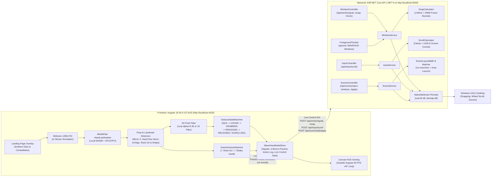

# W.A.V.E 🌊

> **"Windows Are Very Easily-moved"**
> Touchless, spatial hand-gesture window manager, V-sign scroller, and workspace scene launcher for Windows.

W.A.V.E turns your webcam into a local, zero-latency spatial controller for native Windows desktop apps. Pinch in mid-air to grab the window under your hand, drag toward a screen edge or corner to preview the landing zone, release to snap real OS windows flush into place, hold up a peace sign (✌️ V-sign) to scroll, swipe a sideways palm to switch apps, or throw an orthogonal hand sign (**🤘 Rock-On** or **🤙 Shaka**) to instantly launch and restore multi-window workspaces.

- **100% Local Vision:** Powered by `@mediapipe/tasks-vision` (`HandLandmarker` in `VIDEO` mode with GPU delegate + CPU fallback) bundled offline in `frontend/src/assets/mediapipe/`. Zero video frames ever leave your device.
- **Wave Scenes (Multi-Window Workspace Launcher):** Build custom multi-window desktop layouts (e.g., Chrome on left, IDE on right, Discord in quarter). W.A.V.E automatically launches closed apps via Win32 executable paths, un-maximizes windows, applies DWM invisible border compensation, and snaps them flush with exact z-ordering.
- **Orthogonal Scene Signs (Zero Interference):** Trigger scenes in mid-air with **🤘 Rock-On** (Index + Pinky extended) or **🤙 Shaka** (Thumb + Pinky extended) with dedicated dwell and cooldown timers—guaranteed zero false triggers with Pinch-Grab or V-Sign Scroll.
- **"Six Moves to Master" Interactive Checklist:** Learn and practice every gesture with live visual feedback:
  1. `01 Move` — Open hand cursor tracking
  2. `02 Pinch & grab` — Pinch thumb and index to grab windows
  3. `03 Snap to edge` — Drag to edges/corners and release
  4. `04 Wave Scenes` — Hold 🤘 Rock-On or 🤙 Shaka to launch scenes
  5. `05 Scroll` — Hold peace sign ✌️ and move hand up/down
  6. `06 Switch apps` — Sideways open palm swipe up (Alt+Tab)
- **Native Win32 Precision:** ASP.NET Core Web API backend (`user32.dll`, `dwmapi.dll`, `shcore.dll`) with per-monitor DPI awareness (`PER_MONITOR_AWARE_V2`), work-area awareness (`rcWork` so the taskbar is never covered), DWM Extended Frame Bounds compensation (`DWMWA_EXTENDED_FRAME_BOUNDS`), and native mouse wheel injection (`SendInput` with `MOUSEEVENTF_WHEEL = 0x0800`).
- **Always-on-Top Floating PiP:** Document Picture-in-Picture (`documentPictureInPicture`) lets you pop the live HUD into an always-on-top floating window over all other desktop apps.
- **Mouse Simulation Mode Included:** Press **Simulate** (or hand icon) in the header to demo the entire gesture pipeline with mouse & keyboard: Click & drag = Pinch-Grab, hold `Shift` + move mouse = V-Sign Scroll, press `3`/`4` = Rock-On/Shaka scenes.

---

## Prerequisites & Dependencies

### System Requirements
| Requirement | Specification | Notes |
| :--- | :--- | :--- |
| **Operating System** | **Windows 10 or Windows 11 (64-bit)** | Required for native Win32 `user32.dll` and `dwmapi.dll` window APIs and `SendInput`. |
| **.NET SDK** | **.NET 8.0 SDK (LTS)** | **.NET 10 is NOT required.** Any standard .NET 8.0 SDK (or newer LTS) builds and runs the solution. |
| **Node.js & npm** | **Node.js `v18.19+` or `v20+`** (with npm) | Required to run Angular 18 CLI and frontend dependencies. |
| **Webcam** | Integrated laptop camera or USB webcam | Optional if using built-in **Mouse Simulation** mode. |

---

### Backend Dependencies (`backend/Scepter.Api`)
The backend is an ASP.NET Core Web API targeting **`net8.0`**:

- **Runtime & Framework:**
  - `Microsoft.NET.Sdk.Web` targeting `.NET 8.0` (`net8.0`)
- **NuGet Packages:**
  - `Swashbuckle.AspNetCore` (`6.6.2`) — Swagger API documentation UI
- **Test Project (`backend/Scepter.Api.Tests`):**
  - `xunit` (`2.5.3`) — Unit testing framework
  - `xunit.runner.visualstudio` (`2.5.3`) — Test runner
  - `Microsoft.NET.Test.Sdk` (`17.8.0`) — .NET test SDK
  - `coverlet.collector` (`6.0.0`) — Code coverage collector
- **Windows System DLLs (P/Invoke):**
  - `user32.dll` (`GetForegroundWindow`, `SetWindowPos`, `ShowWindow`, `WindowFromPoint`, `SendInput`, `SetCursorPos`, etc.)
  - `dwmapi.dll` (`DwmGetWindowAttribute` with `DWMWA_EXTENDED_FRAME_BOUNDS`)
  - `shcore.dll` (`SetProcessDpiAwarenessContext` with `DPI_AWARENESS_CONTEXT_PER_MONITOR_AWARE_V2`)

---

### Frontend Dependencies (`frontend/package.json`)
The frontend is an Angular 18 standalone application:

- **Core Framework:**
  - `@angular/core`, `@angular/common`, `@angular/compiler`, `@angular/platform-browser`, `@angular/router`, `@angular/forms`, `@angular/animations` (`^18.2.0`)
  - `zone.js` (`~0.14.10`)
  - `rxjs` (`~7.8.0`)
  - `tslib` (`^2.3.0`)
- **Computer Vision & Hand Tracking:**
  - `@mediapipe/tasks-vision` (`0.10.18`) — Google MediaPipe Hand Landmarker runtime
  - Bundled offline assets in `frontend/src/assets/mediapipe/`:
    - `hand_landmarker.task` (MediaPipe neural network model file)
    - `vision_wasm_internal.js` & `vision_wasm_internal.wasm`
    - `vision_wasm_nosimd_internal.js` & `vision_wasm_nosimd_internal.wasm`
- **Developer Tools & Testing:**
  - `@angular/cli` (`^18.2.0`)
  - `@angular-devkit/build-angular` (`^18.2.0`)
  - `typescript` (`~5.5.2`)
  - `vitest` (`^2.1.0`) — Fast unit test runner for pose and gesture algorithms

---

## Repository Structure

Frontend and backend live in strictly separated top-level folders and build/run independently:

```text
WAVE/
├── README.md              # Setup, dependencies, architecture, run instructions, demo script
├── docs/
│   └── api-contract.md    # Full HTTP contract (/health, /api/window/*, /api/input/*, /api/scenes/*)
├── frontend/              # Angular 18 standalone app (http://localhost:4200)
│   ├── src/
│   │   ├── index.html     # <title>WAVEHUD</title> (never changes at runtime; ignored by backend)
│   │   ├── assets/
│   │   │   ├── fonts/     # Bundled Space Grotesk Variable & JetBrains Mono woff2 fonts
│   │   │   ├── mediapipe/ # Local offline hand_landmarker.task + WASM binaries
│   │   │   └── wave-landing-figure.jpg # Constellation landing page emblem
│   │   └── app/
│   │       ├── core/
│   │       │   ├── models/   # landmark.model.ts, gesture.model.ts, snap-action.model.ts, scene.model.ts
│   │       │   ├── services/ # wave-view-model.store, gesture-engine, window-api, scene-api, camera, hand-tracker, settings
│   │       │   └── utils/    # pose.ts (isVSign + scroll math), scene-gesture.detector.ts (Rock-On/Shaka), lerp.ts, geometry.ts
│   │       └── features/
│   │           ├── scepter-shell/   # Main W.A.V.E stage, landing modal, telemetry, 6 moves panel, guide
│   │           ├── hud-overlay/     # Outside-zone rAF Canvas skeleton, pinch ring, progress rings, scroll arrows
│   │           ├── scenes-panel/    # Wave Scenes workspace builder, custom app picker & zone assigner
│   │           └── settings-panel/  # Slide-over calibration drawer + action log
└── backend/               # ASP.NET Core Web API (.NET 8, http://localhost:5000)
    ├── Scepter.sln
    ├── Scepter.slnx
    ├── Scepter.Api/
    │   ├── Program.cs       # Kestrel configuration, CORS, DPI awareness V2
    │   ├── appsettings.json # Scepter:SelfWindowTitleMatch = "WAVEHUD", Wave:Scenes:Enabled = true
    │   ├── Controllers/
    │   │   ├── WindowController.cs  # /api/window/active, /list, /grab, /move, /snap, /resize, /cycle
    │   │   ├── InputController.cs   # /api/input/scroll (SendInput mouse wheel injection)
    │   │   └── ScenesController.cs  # /api/scenes (open-windows, CRUD, apply, undo)
    │   ├── Services/
    │   │   ├── WindowService.cs, InputService.cs, ForegroundTracker.cs
    │   │   ├── SnapCalculator.cs, ScrollCalculator.cs
    │   │   └── SceneService.cs, SceneMatcher.cs, SceneLayoutMath.cs
    │   ├── Native/
    │   │   ├── NativeMethods.cs, NativeStructs.cs
    │   │   └── SceneNativeMethods.cs (SW_RESTORE, SetWindowPos, ForceForegroundWindow, Process Start)
    │   └── Models/
    │       ├── SnapPosition.cs, GrabRequest.cs, SnapRequest.cs, ScrollRequest.cs, SnapResult.cs
    │       └── SceneModels.cs (SceneSummary, SceneDefinition, SelectedSceneWindowInput)
    └── Scepter.Api.Tests/
        ├── SnapCalculatorTests.cs   # Pure xUnit rectangle & DWM border math tests
        ├── ScrollCalculatorTests.cs # Pure xUnit scroll clamping, coordinate, & x64 INPUT struct tests
        ├── SceneLayoutMathTests.cs  # Pure xUnit zone rect calculations & resolution scaling
        ├── SceneMatcherTests.cs     # HWND and process title matching tests
        └── SceneServiceTests.cs     # Scene capture, storage, and apply tests
```

---

## Architecture Diagram



---

## Keyboard Shortcuts & Quick Reference

| Key | Action | Context |
| :---: | :--- | :--- |
| **`Enter`** | Start camera & enter application | Landing page |
| **`W`** | Open / close **Wave Scenes** manager | Any screen |
| **`U`** | **Undo** last applied scene layout | When scene was restored |
| **`S`** | Open / close **Settings** drawer | Any screen |
| **`C`** | Open / close **Gesture Guide** tutorial modal | Any screen |
| **`M`** | Toggle audio cues (Mute / Unmute) | Any screen |
| **`Esc`** | Close open modals, drawers, or guide | Any modal / drawer |
| **`Shift` + Move** | Simulate V-sign scrolling | In **Simulate** mode |
| **`3`** | Simulate 🤘 **Rock-On** scene gesture | In **Simulate** mode |
| **`4`** | Simulate 🤙 **Shaka** scene gesture | In **Simulate** mode |

---

## Backend Setup & Run (`/backend`)

1. Open a PowerShell terminal in `backend/Scepter.Api`:
   ```powershell
   cd backend/Scepter.Api
   dotnet run
   ```
   - Listens on `http://localhost:5000`.
   - Swagger UI: `http://localhost:5000/swagger`.
   - Health check: `GET http://localhost:5000/health` -> `{"status":"ok","platform":"windows",...}`.

2. Run backend unit tests (`xUnit` — 42 tests covering snap math, scroll limits, DWM padding, and scene restoration):
   ```powershell
   cd backend
   dotnet test Scepter.sln
   ```

---

## Frontend Setup & Run (`/frontend`)

1. Open a second terminal in `frontend`, install dependencies, and start the development server:
   ```powershell
   cd frontend
   npm install
   npm start
   ```
   - Serves at `http://localhost:4200`.

2. Run frontend unit tests (`Vitest` — 27 tests covering pose math, gesture state machine, Rock-On/Shaka detection, and store actions):
   ```powershell
   cd frontend
   npm test
   ```

3. Build production bundle (tested with Angular 18):
   ```powershell
   cd frontend
   npm run build
   ```

---

## Tunable Parameters (Live in Settings Drawer)

Open the **Settings** drawer (`S` key or top-right sliders icon) to adjust parameters live (persisted to `localStorage` and resettable via **Reset to defaults**):

| Parameter | Default | Description |
| :--- | :--- | :--- |
| **Live control (Win32)** | `false` (Off) | Gates all OS window actions. When off, W.A.V.E operates safely in Practice mode. |
| **Cursor Smoothing Filter** | `Lerp` | Switch live between Linear Interpolation (`Lerp`) and adaptive `One Euro (1€)` filtering. |
| **Lerp Smoothing Alpha** | `0.35` | `smoothed = prev + (raw - prev) * alpha`. Applied to pinch and cursor coordinates. |
| **Pinch Enter Threshold** | `0.28` | Normalized thumb-to-index distance (wrist `#0` to middle MCP `#9`). |
| **Hysteresis Exit Multiplier** | `1.50x` | Exit threshold = `enter * 1.50` (`0.42`). Eliminates pinch boundary flicker. |
| **Edge Snap Zone Width** | `20%` | Screen edge margin (`X < 0.20` Left, `X > 0.80` Right, `Y < 0.20` Top Maximize, plus 4 corners). |
| **Zone Arm Dwell Time** | `150 ms` | Dwell duration in an edge zone before arming snap. |
| **Left/Right Split Ratio** | `50%` | Width split ratio (`0.30` – `0.70`) sent to `POST /api/window/snap`. |
| **V-Sign Scroll Enabled** | `true` | Enables peace-sign (`isVSign`) vertical scrolling. |
| **Scroll Direction** | `Natural` | `Natural` (hand up = scroll up) or `Inverted` (`invertScroll: true`). |
| **Scroll Gain** | `4000` | Wheel units per normalized frame height (clamped to `±1200` per request). |
| **V-Sign Spread Min** | `0.35` | Normalized distance `dist(8,12) / dist(0,9)` separating a V-sign from closed fingers. |
| **Wave Scenes Enabled** | `true` | Enables multi-window scenes capture and restoration. |
| **Scene Hold Time** | `400 ms` | Dwell duration required to trigger 🤘 Rock-On or 🤙 Shaka scene signs. |
| **Scene Cooldown** | `1500 ms` | Cooldown preventing repeated scene launches after a sign trigger. |

---

## Known Limitations & Tips

1. **Windows 10/11 for Native Win32 Actions:** Physical desktop window positioning and mouse wheel injection require Windows OS APIs (`user32.dll`, `dwmapi.dll`).
2. **Never Change `<title>WAVEHUD</title>`:** Both `frontend/src/index.html` (`<title>WAVEHUD</title>`) and `backend/Scepter.Api/appsettings.json` (`"SelfWindowTitleMatch": "WAVEHUD"`) must match so W.A.V.E never grabs or snaps its own window.
3. **Elevated (Administrator) Windows (UIPI):** Windows User Interface Privilege Isolation blocks non-elevated processes from sending inputs or moving elevated admin windows. To manage admin windows, run `dotnet run` in an Administrator PowerShell terminal.
4. **Background Tab Throttling:** Chrome and Edge throttle webcam and `requestAnimationFrame` processing when tabs are hidden. Keep W.A.V.E visible on screen, or click the **Picture-in-Picture (PiP)** button to pop out an always-on-top floating HUD.
