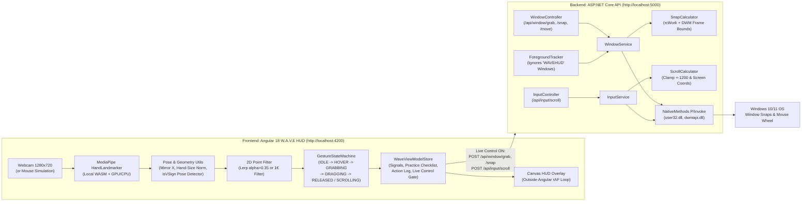

# W.A.V.E 🌊

> **"Windows Are Very Easily-moved"**
> Touchless, spatial hand-gesture window manager & V-sign scroller for Windows.

W.A.V.E turns your laptop webcam into a local, zero-latency spatial controller for native Windows desktop apps. Pinch in mid-air to grab the window under your hand, drag toward a screen edge or corner to preview the landing zone, release to snap real OS windows flush into place, or hold up a peace sign (V-sign) and move your hand up or down to scroll any window under your cursor.

- **100% Local Vision:** Powered by `@mediapipe/tasks-vision` (`HandLandmarker` in `VIDEO` mode with GPU delegate + CPU fallback) bundled offline in `frontend/src/assets/mediapipe/`. Zero video frames ever leave your device.
- **Practice Mode & Live Control Gate:** Starts safely in **Practice mode** (`Live control off`) with an interactive 4-step gesture checklist (**Hover, Grab, Snap to edge, Scroll**). Toggle **Live control on** in the header when ready to control real Windows apps.
- **Native Win32 Precision:** ASP.NET Core Web API backend (`user32.dll`, `dwmapi.dll`, `shcore.dll`) with per-monitor DPI awareness (`PER_MONITOR_AWARE_V2`), work-area awareness (`rcWork` so the taskbar is never covered), DWM Extended Frame Bounds compensation (`DWMWA_EXTENDED_FRAME_BOUNDS`), and native mouse wheel injection (`SendInput` with `MOUSEEVENTF_WHEEL = 0x0800`).
- **Mouse Simulation Mode Included:** Toggle **Simulate** in the header to test or demo the entire gesture state machine, Win32 snapping pipeline, and V-sign scrolling with your mouse (click & hold = pinch-grab, drag to edge & release = snap, hold `Shift` + move vertically = V-sign scroll).

---

## Repository Structure

Frontend and backend live in strictly separated top-level folders and build/run independently:

```text
WAVE/
├── README.md              # Setup, architecture, run instructions, 60s demo script
├── docs/
│   └── api-contract.md    # Full HTTP contract (/health, /api/window/*, /api/input/scroll)
├── frontend/              # Angular 18 standalone app (http://localhost:4200)
│   ├── src/
│   │   ├── index.html     # <title>WAVEHUD</title> (never changes at runtime; ignored by backend)
│   │   ├── assets/
│   │   │   ├── fonts/     # Bundled Space Grotesk Variable & JetBrains Mono woff2 fonts
│   │   │   └── mediapipe/ # Local offline hand_landmarker.task + WASM binaries
│   │   └── app/
│   │       ├── core/
│   │       │   ├── models/   # landmark.model.ts, gesture.model.ts, snap-action.model.ts
│   │       │   ├── services/ # wave-view-model.store, gesture-engine, window-api, camera, hand-tracker, settings
│   │       │   └── utils/    # pose.ts (isVSign + scroll math), lerp.ts (Lerp & 1€), geometry.ts
│   │       └── features/
│   │           ├── scepter-shell/   # Main W.A.V.E stage, telemetry, practice checklist, guide
│   │           ├── hud-overlay/     # Outside-zone rAF Canvas skeleton, pinch ring, scroll arrow
│   │           └── settings-panel/  # Slide-over calibration drawer + action log
└── backend/               # ASP.NET Core Web API (.NET 8, http://localhost:5000)
    ├── Scepter.sln
    ├── Scepter.slnx
    ├── Scepter.Api/
    │   ├── Program.cs
    │   ├── appsettings.json # Scepter:SelfWindowTitleMatch = "WAVEHUD"
    │   ├── Controllers/WindowController.cs, InputController.cs
    │   ├── Services/WindowService.cs, InputService.cs, ForegroundTracker.cs, SnapCalculator.cs, ScrollCalculator.cs
    │   ├── Native/NativeMethods.cs, NativeStructs.cs
    │   └── Models/SnapPosition.cs, GrabRequest.cs, SnapRequest.cs, ScrollRequest.cs, SnapResult.cs
    └── Scepter.Api.Tests/
        ├── SnapCalculatorTests.cs   # Pure xUnit rectangle & DWM border math tests
        └── ScrollCalculatorTests.cs # Pure xUnit scroll clamping, coordinate, & x64 INPUT struct tests
```

---

## Architecture Diagram



---

## Prerequisites

- **OS:** Windows 10 or Windows 11 (required for Win32 window manipulation and `SendInput` wheel injection; non-Windows platforms return HTTP `501 Not Implemented`).
- **.NET SDK:** .NET 8.0 SDK (or .NET 9/10 SDK targeting `net8.0`).
- **Node.js & npm:** Node.js `v18.19+` or `v20+` and `npm`.
- **Webcam:** Any standard USB or integrated laptop webcam (optional when using **Simulate** mode).

---

## Backend Setup & Run (`/backend`)

1. Open a terminal in `backend/Scepter.Api` and start the API:
   ```powershell
   cd backend/Scepter.Api
   dotnet run
   ```
   - The server binds to `http://localhost:5000`.
   - Swagger UI is available in Development at `http://localhost:5000/swagger`.
   - Health check endpoint: `GET http://localhost:5000/health` -> `{"status":"ok","platform":"windows",...}`.

2. Run the backend unit test suite (`xUnit`):
   ```powershell
   cd backend
   dotnet test Scepter.sln
   ```

---

## Frontend Setup & Run (`/frontend`)

1. Open a second terminal in `frontend`, install dependencies, and start the dev server:
   ```powershell
   cd frontend
   npm install
   npm start
   ```
   - Serves at `http://localhost:4200`.

2. Run the frontend unit tests (`Vitest`):
   ```powershell
   cd frontend
   npm test
   ```

---

## Tunable Parameters (Live in Settings Drawer)

Open the **Settings** drawer (`S` key or top-right sliders icon) to tune all gesture and scroll parameters live (persisted to `localStorage` and resettable via **Reset to defaults**):

| Parameter | Default | Description |
| :--- | :--- | :--- |
| **Live control (Win32)** | `false` (Off) | Gates all `/grab`, `/move`, `/snap`, `/resize`, `/cycle`, and `/scroll` calls inside `WindowApiService`. Health polling always runs. |
| **Cursor Smoothing Filter** | `Lerp` | Switch live between Linear Interpolation (`Lerp`) and adaptive `One Euro (1€)` filtering. |
| **Lerp Smoothing Alpha** | `0.35` | `smoothed = prev + (raw - prev) * alpha`. Applied to both pinch and V-sign midpoints. |
| **Pinch Enter Threshold** | `0.28` | Thumb-to-index distance normalized by hand size (wrist `#0` to middle MCP `#9`). |
| **Hysteresis Exit Multiplier** | `1.50x` | Exit threshold = `enter * 1.50` (`0.42`). Eliminates pinch boundary flicker. |
| **Edge Snap Zone Width** | `20%` | Screen edge margin (`X < 0.20` Left, `X > 0.80` Right, `Y < 0.20` Top Maximize, plus 4 corners). |
| **Zone Arm Dwell Time** | `150 ms` | Time the pinched cursor must dwell inside an edge zone before it arms. |
| **Snap Release Cooldown** | `800 ms` | Minimum time between consecutive snap actions. |
| **Left/Right Split Ratio** | `50%` | Width ratio (`0.30` – `0.70`) sent to `POST /api/window/snap`. |
| **V-Sign Scroll Enabled** | `true` | Enables peace-sign (`isVSign`) vertical scrolling. Pinch always takes priority. |
| **Scroll Direction** | `Natural` | `Natural` (hand up = scroll up, positive wheel delta) or `Inverted` (`invertScroll: true`). |
| **Scroll Gain** | `4000` | Wheel units per normalized frame height (`~1000` wheel units for a 25% vertical stroke, with `|dy|^1.2` curve). |
| **Scroll Deadzone** | `0.002` | Minimum per-frame normalized `|dy|` before accumulating wheel movement. |
| **V-Sign Spread Min** | `0.35` | Minimum normalized distance `dist(8,12) / dist(0,9)` separating a V-sign from two fingers held together. |
| **Scroll Enter / Exit Hold** | `120 ms` / `150 ms` | Dwell times to enter and exit `SCROLLING` without flicker. Batching sends at most ~30 requests/sec clamped to `±1200`. |

---

## 60-Second Demo Script

1. **0:00 – 0:15 | Safe Practice Checklist (`0/4` -> `4/4`):**
   Open `http://localhost:4200`. Point out the **Backend connected** pill and **Live control off** (Practice mode). Click **Start camera** (or **Simulate**). Perform **Hover** (open hand), **Grab** (pinch thumb & index), **Snap to edge** (drag to left edge until armed and release), and **Scroll** (hold V-sign and move up/down, or hold `Shift` + move mouse in Simulation mode). Watch all 4 practice cards tick green (`Practice · 4/4`).
2. **0:15 – 0:35 | Live Window Grab & Edge Snapping:**
   Open a scrollable window (such as Notepad or a documentation page) alongside W.A.V.E. Click **Live control off -> Live control on** in the header. Pinch to grab the target window, drag into the left zone until **ARMED · LEFT** appears with the window title inside the ghost preview, and release — the window snaps flush to the left half of the display without covering the taskbar (`rcWork`) or leaving DWM border gaps.
3. **0:35 – 0:50 | V-Sign Touchless Scrolling:**
   Point at the scrollable window and hold a peace sign (**V-sign**: index & middle extended and spread, ring & pinky curled). On entry, the Windows cursor jumps once to your hand's position (`begin: true`), the HUD displays **SCROLL** with highlighted index/middle fingertips and a speed-proportional directional arrow, and moving your hand up/down smoothly scrolls the window.
4. **0:50 – 1:00 | Live Calibration & Action Log:**
   Press `S` to open the **W.A.V.E Settings** drawer. Flip **Scroll Direction** between **Natural** and **Inverted**, adjust **Scroll Gain**, and inspect the timestamped **Recent Action Log**.

---

## Known Limitations

1. **Windows 10/11 Only:** Native window positioning and `SendInput` mouse wheel injection require Win32 `user32.dll`, `dwmapi.dll`, and `shcore.dll`.
2. **Browser Tab Must Stay Visible:** Browsers throttle `requestAnimationFrame` and camera streams in hidden tabs. W.A.V.E displays a warning banner if the tab is backgrounded; use the **Compact** toggle or **Picture-in-Picture (PiP)** button to keep the HUD visible while working in other apps.
3. **Never Rename `<title>WAVEHUD</title>`:** Both `frontend/src/index.html` (`<title>WAVEHUD</title>`) and `backend/Scepter.Api/appsettings.json` (`"SelfWindowTitleMatch": "WAVEHUD"`) must match so the backend never grabs or snaps the W.A.V.E HUD window itself.
4. **Elevated (Administrator) Windows (UIPI):** Windows User Interface Privilege Isolation prevents a normal-privilege process from moving or injecting `SendInput` wheel events into an elevated Administrator window. Run the backend in an Administrator terminal if you want to snap or scroll elevated apps.
5. **Lighting:** Standard indoor lighting works best for MediaPipe hand landmark tracking; in low light or on machines without a webcam, use **Simulate** mode.
